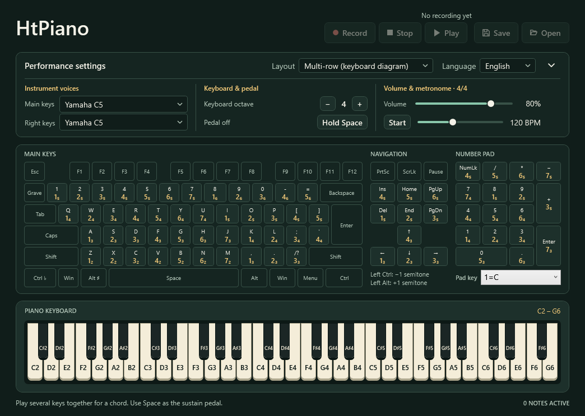

# HtPiano

[中文](#中文) · [English](#english)



## 中文

HtPiano 把普通电脑键盘变成一架采样钢琴。左手可以在字母区弹钢琴，右手用数字小键盘弹马林巴。弹到满意的一遍，就把它存下来；下次打开，不光能听到，还能看到自己按过哪些键。

### 先弹一个和弦

1. 在 Windows x64 上打开 `HtPiano.exe`。默认设置下，按 **Q、E、T** 分别是 C4、E4、G4，同时按就是 C 大三和弦。没有小键盘也能弹；屏幕上的黑白琴键可以直接用鼠标点。
2. 按住**空格**，再松开琴键，声音会延续到松开空格为止。在「演奏设置」里可以分别给两个键区选音色，也可以打开 4/4 节拍器。
3. 数字小键盘按简谱弹：默认 `1=C`。**单按左 Ctrl 降半音，单按左 Alt 升半音**。指法不变，主键区和方向键也不跟着变调。「经典」布局只隐藏电脑键盘图，不改键位。

### 录下这一遍

点 **录制 → 弹奏 → 停止 → 播放**。要留到下次，点**保存**，得到一个 `.htkeys` 文件。它记的是按键、音高、音色和时间，不是 WAV，也不录麦克风。用**打开**载入文件，钢琴会按原来的节奏回放，包括和弦、换调后的音高和延音；节拍器的声音不会录进去。

### 运行与编译

运行现成的程序需要 Windows x64、[.NET 10 桌面运行时][dotnet] 和 [Visual C++ v14 x64 运行库][vcredist]。请保留整个程序目录，不要只复制 EXE。

从源码编译需要 Windows x64 和 **.NET 10 SDK**。[PianoNative 目录](sdk/PianoNative/)已附上 `htpiano.h` 和预编译的 `htpiano.dll`，不需要另外下载音源或编译 C++。在项目根目录运行下方命令即可。

## English

HtPiano turns a PC keyboard into a sampled piano. Play piano with one hand and marimba on the number pad with the other. Save a take and open it later to hear what you played and see the keys light up in time.

### Play a chord

1. Open `HtPiano.exe` on Windows x64. With the default layout, **Q, E and T** play C4, E4 and G4. Press them together for a C major chord. You can also click the piano keys, including the black keys. A number pad is optional.
2. Hold **Space**, play the chord and lift your fingers. The notes ring until you release Space. Open **Performance settings** to choose a voice for each hand or turn on the 4/4 metronome.
3. The number pad starts in C: **1, 2, 3** play C, D, E. Tap **left Ctrl** to transpose down a semitone or **left Alt** to transpose up. Only the number pad changes pitch. **Classic** hides the keyboard diagram without changing the fingering.

### Keep a take

Click **Record**, play, then click **Stop** and **Play**. **Save** writes a `.htkeys` file; **Open** plays it immediately. A take stores timed key presses and musical events, not audio. Chords, instrument changes, transposed notes and sustain are preserved. The metronome click is left out.

### Run or build

To run a built copy, install the [x64 .NET 10 Desktop Runtime][dotnet] and the [Visual C++ v14 x64 Redistributable][vcredist]. Keep the application folder together: the EXE needs the native library and sample bank beside it in their original locations.

To build from source, install the **.NET 10 SDK** on Windows x64 and run the commands below from the project root. The [PianoNative directory](sdk/PianoNative/) includes the C header and prebuilt Windows x64 DLL. No separate SDK download or C++ compiler is needed.

## PowerShell

```powershell
dotnet build .\solution\HtPiano.slnx -c Release -p:Platform=x64
.\HtPiano\bin\x64\Release\net10.0-windows\HtPiano.exe
```

也可以用 Visual Studio 2026 打开 [HtPiano.slnx](solution/HtPiano.slnx)，选择 **x64** 后按 **F5**。  
In Visual Studio 2026, open [HtPiano.slnx](solution/HtPiano.slnx), select **x64** and press **F5**.

- **语言 / Languages** — 在演奏设置中切换语言。To add a translation without rebuilding, see the [JSON language pack guide](HtPiano/Languages/README.md).
- **文件关联 / File association** — 如需双击 `.htkeys` 自动播放，可为当前账户运行以下命令。To open saved takes from Explorer, register the build you intend to keep:

  ```powershell
  .\solution\Register-TakeFiles.ps1 -Executable .\HtPiano\bin\x64\Release\net10.0-windows\HtPiano.exe
  ```

## 许可 / License

- **客户端和头文件**：HtPiano 客户端（包括 UI 和调用代码）以及 [`htpiano.h`](sdk/PianoNative/htpiano.h) 使用 [MIT 许可证](LICENSE)，可用于商业或非商业项目。
- **音源**：PianoNative 的 C++ 实现保持闭源。非商业项目可以使用 `htpiano.dll`，并把它**原样随自己的程序分发**。商业使用或商业分发须另行取得 Herbert Yeung 的授权。详见 [DLL 授权条款](sdk/PianoNative/DLL-LICENSE.txt)。
- **音色采样**：Salamander 钢琴采样使用 CC BY 3.0，大键琴和马林巴的 VCSL 采样使用 CC0 1.0。见[采样署名](ATTRIBUTION.md)。

- **Client and header:** The HtPiano client (UI and calling code) and [`htpiano.h`](sdk/PianoNative/htpiano.h) use the [MIT License](LICENSE). Both commercial and non-commercial projects may use them.
- **Audio engine:** The PianoNative C++ implementation is closed source. Non-commercial projects may use `htpiano.dll` and distribute it **unchanged with their application**. Commercial use or commercial distribution requires separate authorization from Herbert Yeung. See the [DLL license](sdk/PianoNative/DLL-LICENSE.txt).
- **Samples:** The Salamander piano recordings are CC BY 3.0. The VCSL harpsichord and marimba recordings are CC0 1.0. See the [sample credits](ATTRIBUTION.md).

[dotnet]: https://dotnet.microsoft.com/en-us/download/dotnet/10.0
[vcredist]: https://learn.microsoft.com/en-us/cpp/windows/latest-supported-vc-redist
